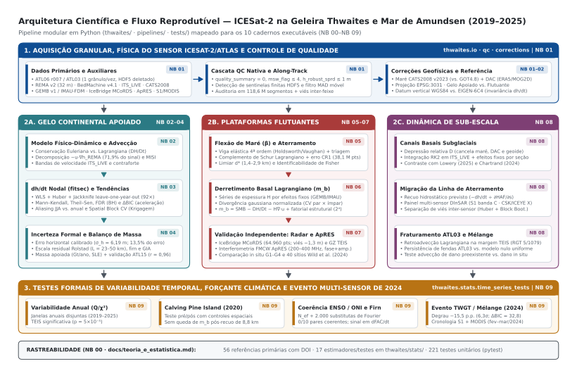

# ICESat-2 ATL06 — Geleira Thwaites e Mar de Amundsen (2019–2025)

[](https://github.com/williamjot/thwaites-icesat2-ase/actions/workflows/ci.yml)

[](LICENSE)

Biblioteca científica e pipeline modular em Python para altimetria laser ICESat-2 (ATL06 r007) na Geleira Thwaites e no setor do Mar de Amundsen (*Amundsen Sea Embayment* — ASE, Antártica Ocidental). O repositório integra num mesmo arcabouço observacional e estatístico:

1. **Gelo continental apoiado (*grounded ice*):** extração seletiva por grânulo, filtragem pelos flags nativos do ATL06, maré regional CATS2008, correção atmosférica dinâmica (DAC), referenciação topográfica com REMA v2 (32 m), ajuste espaço-temporal local (`fitsec`), incerteza nodal por jackknife agrupado por ano, seleção de interpolador por validação cruzada espacial em blocos, correção de conteúdo de ar do firn (GSFC-FDM), ajuste isostático glacial (GIA) e integração do balanço de massa ($-105{,}4 \pm 9{,}2\text{ Gt/ano}$; $0{,}29 \pm 0{,}03\text{ mm/ano}$ de nível do mar).
2. **Plataformas de gelo flutuante (*floating ice shelves* — Pine Island, Thwaites Oriental/TEIS, Crosson, Dotson e Cosgrove):** medição da resposta à maré ($\beta$) com eliminação analítica da topografia móvel Lagrangiana via complemento de Schur e erros-padrão agrupados CR1 por passagem orbital, delimitação empírica da zona de flexão ($d^* \in [1{,}4;\; 2{,}9]\text{ km}$), séries de espessura hidrostática por efeitos fixos de célula material, divergência de velocidade ($\nabla\cdot\mathbf{u}$) por convolução diferencial gaussiana normalizada com escala selecionada por validação cruzada entre anos pares e ímpares, conservação de massa Lagrangiana ($m_b = \text{SMB} - DH/Dt - H\nabla\cdot\mathbf{u}$), recuperação da zona de aterramento da TEIS com radar aerotransportado IceBridge MCoRDS, validação *in situ* com radar de fase ApRES (ITGC MELT) e avaliação de incerteza estrutural em projeto fatorial completo ($5.184\text{ a }6.912$ combinações por plataforma).
3. **Testes formais de variabilidade e mudança de regime (2019–2025):** homogeneidade interanual pelo teste $Q/\chi^2$ de Cochran em janelas anuais disjuntas, teste quase-experimental pré/pós-desprendimento da Pine Island em 2020, teste de coerência com o ENSO (ONI) utilizando graus de liberdade efetivos ($N_{\text{ef}}$ de Bretherton e Pyper–Peterman) e $2.000$ séries substitutas por randomização de fase de Fourier, além da quantificação multi-sensor (ICESat-2, Sentinel-1 e MODIS) da perda de gelo no tronco oeste da Thwaites em 2024.

---

## Arquitetura do Repositório

```text
├── thwaites/                        # Biblioteca científica principal
│   ├── io/                          # Download granular (earthaccess + deleção HDF5 em finally), Parquet/NetCDF
│   ├── qc/                          # Flags ATL06, filtro along-track MAD, máscaras de domínio e crossovers
│   ├── corrections/                 # Maré CATS2008 (pyTMD), DAC, REMA v2, firn (GSFC/GEMB/IMAU), GIA e datum
│   ├── grid/                        # Projeção polar estereográfica (EPSG:3031) e particionamento em tiles com halo
│   ├── stats/                       # Inferência estatística, reamostragem em blocos, painel/Schur e validação cruzada
│   │   ├── trend_tests.py           #   Mann-Kendall, MK Sazonal, Theil-Sen e controle FDR (Benjamini-Hochberg)
│   │   ├── resampling.py            #   Jackknife leave-one-year-out, Delete-a-Group Jackknife e Block Bootstrap
│   │   ├── panel_schur.py           #   Efeitos fixos de célula material, complemento de Schur (FWL) e variância CR1
│   │   ├── time_series_tests.py     #   Teste Q/χ² de Cochran, diferença pré/pós, N_ef, substitutas de Fourier e ΔBIC
│   │   └── spatial_cv.py            #   Spatial Block CV, calibração z_std, derivada gaussiana normalizada e Rolstad L
│   ├── timeseries/                  # Ajuste nodal fitsec, seleção de aceleração, injeção harmônica de aliasing
│   ├── interp/                      # Variograma empírico, krigagem ordinária, OI/Markov, IDW e kernels
│   ├── glaciology/                  # Advecção Lagrangiana, divergência de fluxo e forçantes basais
│   ├── flexure/                     # Modelo analítico e diferenças finitas de viga elástica flutuante
│   ├── uncertainty/                 # Calibração de geolocalização horizontal, correlação residual e balanço de massa
│   ├── validation/                  # Processamento FMCW ApRES, concordância spatial/crossovers e dobras sem vazamento
│   └── viz/                         # Rotinas cartográficas e diagnósticas em EPSG:3031
├── pipelines/                       # Executáveis de linha de comando organizados por domínio
│   ├── aquisicao/                   # Download granular ATL06 e recorte de produtos auxiliares (REMA, BedMachine, ITS_LIVE)
│   ├── gelo_apoiado/                # Cadeia principal do gelo apoiado (run_chain.py e etapas modulares)
│   ├── derretimento_basal/          # Cadeia das plataformas flutuantes da ASE (run_basal_ase_all.py e 30 etapas)
│   ├── canais/                      # Análise Lagrangiana de canais subglaciais e comparação com CryoSat-2
│   ├── gl_migration/                # Migração da zona de flexão por ciclo orbital e comparação com InSAR
│   ├── melange/                     # Rugosidade ATL06 e fendas em fótons ATL03 na margem da TEIS
│   ├── experiments/                 # Testes sintéticos de identificabilidade de flexão e sensibilidade de parâmetros
│   ├── products/                    # Séries de massa por temporada, comparação sazonal e hindcast nodal
│   └── figures/                     # Scripts reprodutíveis de geração de gráficos a partir das tabelas derivadas
├── notebooks/                       # Cadernos Jupyter (.ipynb) executados, cobrindo teoria e cada estágio da pesquisa
│   ├── 00 REFERENCIAS TEORICAS.ipynb
│   ├── 01 SENSOR ICESAT2 E QC.ipynb
│   ├── 02 MODELO FISICO DINAMICO.ipynb
│   ├── 03 GELO APOIADO E DHDT.ipynb
│   ├── 04 INCERTEZA E MASSA.ipynb
│   ├── 05 FLEXAO DE MARE E GZ.ipynb
│   ├── 06 DERRETIMENTO BASAL.ipynb
│   ├── 07 VALIDACAO RADAR E APRES.ipynb
│   ├── 08 CANAIS MIGRACAO E MELANGE.ipynb
│   ├── 09 VARIABILIDADE E EVENTO 2024.ipynb
│   └── dados_resumo/                # 74 tabelas CSV/JSON leves de resultados agregados consumidas pelos notebooks
├── docs/
│   ├── arquitetura_pipeline.svg     # Fluxograma vetorial de arquitetura científica e rastreabilidade
│   └── teoria_e_estatistica.md      # Formulação matemática completa e referências bibliográficas primárias
├── tests/                           # Suíte de testes unitários e de verificação analítica (pytest)
├── config/                          # Perfis YAML de configuração (default, jja, djf, anual)
├── CITATION.cff                     # Metadados formais de citação
├── LICENSE                          # Licença MIT
└── pyproject.toml                   # Especificação do pacote e dependências
```

---

## Diagrama Funcional dos Estágios de Processamento



---

## Instalação e Execução dos Testes

Requer Python $\ge 3.11$. Em um ambiente virtual limpo:

```bash
python -m venv .venv
# Windows PowerShell:
.venv\Scripts\Activate.ps1
# Linux / macOS:
# source .venv/bin/activate

python -m pip install --upgrade pip
python -m pip install -e ".[analysis,dev]"
pytest -q
```

Todos os testes unitários e de verificação analítica em `tests/` são autocontidos e executam sem necessidade dos dados brutos de satélite.

---

## Guia dos Notebooks por Estágio da Pesquisa

Os cadernos em `notebooks/` contêm a dedução teórica, a verificação experimental dos estimadores em código executável e as tabelas/gráficos de resultados de cada etapa:

| Notebook | Conteúdo Científico e Resultados Apresentados |
|---|---|
| [`00 REFERENCIAS TEORICAS.ipynb`](notebooks/00%20REFERENCIAS%20TEORICAS.ipynb) | Compêndio com 56 referências primárias com DOI, deduções matemáticas de todos os modelos físicos e dos 17 testes/estimadores estatísticos, demonstração do Teorema de Frisch–Waugh–Lovell / Complemento de Schur, variância agrupada CR1 e teorema de Wiener–Khinchin para séries substitutas de fase de Fourier. |
| [`01 SENSOR ICESAT2 E QC.ipynb`](notebooks/01%20SENSOR%20ICESAT2%20E%20QC.ipynb) | Física do lidar contador de fótons ATLAS (532 nm, 10 kHz, 6 feixes em 3 pares forte/fraco 4:1), algoritmo ATL06 (segmentos de 40 m a cada 20 m, *first-photon bias*, `msw_flag`), armadilhas de `delta_time` e sentinelas finitas HDF5, auditoria empírica sobre 118,6 M segmentos, maré CATS2008 v2023 vs. GOT4.8, viés inter-feixe e filtro along-track por MAD móvel. |
| [`02 MODELO FISICO DINAMICO.ipynb`](notebooks/02%20MODELO%20FISICO%20DINAMICO.ipynb) | Equação de conservação de massa 3D integrada na vertical (referencial Euleriano vs. Lagrangiano material), quantificação da advecção $\mathbf{v}\cdot\nabla h$ (71,9% do sinal local), física da Instabilidade do Manto de Gelo Marinho (MISI; Weertman, 1974; Schoof, 2007) sobre leito retrógrado e *buttressing* (Gudmundsson, 2013), classificação dinâmica conjunta $\text{dh/dt} \times \|\mathbf{u}\|$ e erro de gradiente geoidal EIGEN-6C4 + DTU15MDT. |
| [`03 GELO APOIADO E DHDT.ipynb`](notebooks/03%20GELO%20APOIADO%20E%20DHDT.ipynb) | Máscara BedMachine v4.1 e buffers físicos, filtro posicional de nós (`dhdt_nodes_qc`, skewness $-2{,}47 \to -2{,}01$), ajuste `fitsec`, Mann–Kendall/Theil–Sen com FDR, seleção de aceleração ($\Delta\text{AIC}_c$, Block Bootstrap, rejeição de 99,6% por AR1), decomposição do viés sazonal JJA vs. anual (aliasing ATBD, firn FDM e ATL15), rota livre de modelo por medianas em painel balanceado e seleção da Krigagem Ordinária por *Spatial Block CV*. |
| [`04 INCERTEZA E MASSA.ipynb`](notebooks/04%20INCERTEZA%20E%20MASSA.ipynb) | Jackknife *leave-one-year-out* (inflação de $92{,}4\times$), calibração empírica do erro de apontamento horizontal ($\sigma_{\text{horiz}} = 6{,}19\text{ m}$, $R^2 = 0{,}9978$, 13,5% do erro nodal), integração geoestatística de Rolstad et al. (2009) e sensibilidade ao alcance residual $L \in [20{,}5;\; 154{,}4]\text{ km}$, firn GSFC-FDM, GIA (Caron 2018 vs. GPS Barletta 2018) e séries na célula do núcleo da Thwaites ($-4{,}35 \pm 0{,}10\text{ m/ano}$). |
| [`05 FLEXAO DE MARE E GZ.ipynb`](notebooks/05%20FLEXAO%20DE%20MARE%20E%20GZ.ipynb) | Revisão da literatura da zona de aterramento, EDO de 4ª ordem da viga elástica flutuante (Holdsworth, 1969; Vaughan, 1995), triagem geométrica trilha ICESat-2 $\times$ fluxo ITS_LIVE, solução conjunta de $\beta$ com topografia Lagrangiana via Complemento de Schur em 38,1 M segmentos, limiar $d^*$ por plataforma e análise da Matriz de Informação de Fisher (autovalores $1 : 10^{-2} : 10^{-7} : 0$) demonstrando o limite de identificabilidade da inversão de flexão. |
| [`06 DERRETIMENTO BASAL.ipynb`](notebooks/06%20DERRETIMENTO%20BASAL.ipynb) | Literatura e conservação Lagrangiana $m_b = \text{SMB} - DH/Dt - H\nabla\cdot\mathbf{u}$, séries de espessura por efeitos fixos de célula material (GEMB vs. IMAU-FDM), derivada gaussiana normalizada de $\nabla\cdot\mathbf{u}$ com CV anos pares $\times$ ímpares, krigagem com pepita heterocedástica em blocos de 5 km, diagnóstico multi-escala das manchas negativas (*blue spots*) e fatorial completo de incerteza estrutural ($5.184\text{ / }6.912$ combinações). |
| [`07 VALIDACAO RADAR E APRES.ipynb`](notebooks/07%20VALIDACAO%20RADAR%20E%20APRES.ipynb) | Validação da espessura hidrostática com 2.839 km de radar aerotransportado IceBridge MCoRDS normalizado por voo, recuperação física da zona de aterramento da TEIS ($\beta\cdot\text{maré} + \text{radar}$), teoria eletromagnética e processamento interferométrico FMCW ApRES ($200\text{–}400\text{ MHz}$, Brennan et al., 2014; Nicholls et al., 2015) nos sítios G1–G4 (Davis et al., 2023) e nos 40 pontos de Wild et al. (2024). |
| [`08 CANAIS MIGRACAO E MELANGE.ipynb`](notebooks/08%20CANAIS%20MIGRACAO%20E%20MELANGE.ipynb) | Aprofundamento Lagrangiano de canais basais subglaciais com efeito fixo de seção e comparação com Lowery et al. (2025) e Chartrand et al. (2024); migração da linha de aterramento prevista pela condição de flutuação (HAF) vs. observada por multi-sensor DInSAR (Sentinel-1, CSK, ICEYE) com controle de viés inter-sensor; e teste Lagrangiano de fendas em fótons ATL03 e rugosidade ATL06 na margem de cisalhamento da TEIS. |
| [`09 VARIABILIDADE E EVENTO 2024.ipynb`](notebooks/09%20VARIABILIDADE%20E%20EVENTO%202024.ipynb) | Séries anuais em janelas disjuntas e teste $Q/\chi^2$ de Cochran, teste quase-experimental pré/pós-desprendimento da Pine Island em 2020, teste de coerência com o ENSO (ONI) sob $N_{\text{ef}}$ e 2.000 substitutas de fase de Fourier, e quantificação multi-sensor (ICESat-2 $\Delta\text{BIC}$ + Sentinel-1 + MODIS) da perda do tronco oeste da Thwaites e mélange em 2024. |

---

## Referência Teórica, Licença e Citação

- **Formulação matemática e rastreabilidade estatística:** ver [`docs/teoria_e_estatistica.md`](docs/teoria_e_estatistica.md) e [`00 REFERENCIAS TEORICAS.ipynb`](notebooks/00%20REFERENCIAS%20TEORICAS.ipynb).
- **Licença:** distribuído sob a [Licença MIT](LICENSE).
- **Citação:** metadados formais compatíveis com GitHub/Zenodo disponíveis em [`CITATION.cff`](CITATION.cff).
